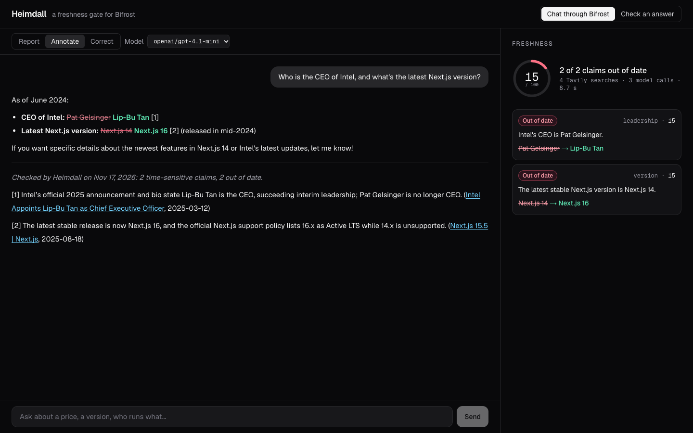

# Heimdall

**A freshness gate for [Bifrost](https://github.com/maximhq/bifrost).** Every LLM answer that crosses the gateway can be checked against today: Heimdall finds the claims that go stale (prices, model and library versions, who runs what, laws and their dates), re-checks each one live with [Tavily](https://tavily.com), and gives it a freshness score, the source it was checked against, and the current value when it has changed.

In Norse myth, Heimdall is the watchman who guards the Bifröst bridge.



```text
As of June 2024, the CEO of Intel is ~~Patrick Gelsinger~~ **Lip-Bu Tan** [1].

---
*Checked by Heimdall on Nov 17, 2026: 2 time-sensitive claims, 2 out of date.*
[1] Intel announced Lip-Bu Tan as CEO effective March 18, 2025… (Intel Newsroom, 2025-03-12)
```

Built for the Geek Room Global AI Hackathon (Nov 2026). Deck: [`docs/heimdall.pptx`](docs/heimdall.pptx). It answers two problem statements at once:

- **Bifrost #4, Open-Source Bifrost Gateway:** a plugin on Bifrost's public extension points (a dynamically loaded Go plugin with HTTP transport hooks) that works with a standard dynamic Bifrost build.
- **Tavily #6, Stale-Answer Detector:** it takes an LLM answer, finds the time-sensitive claims, re-verifies them against live web sources, and scores each claim's freshness.

## Why in the gateway

Language models answer from their training data, so a confident answer can carry a price that was cut last quarter or a CEO who left last year. You could fix that in every app separately. In the gateway, you fix it once: every app behind Bifrost gets the check with one request header, without changing its SDK.

## How it works

```text
 app ──► Bifrost ──► provider (any model)
           │  ▲
           │  └── HTTPTransportPostHook: the answer comes back
           ▼
        Heimdall
           1. extract   time-sensitive claims (check model, through Bifrost)
           2. search    each claim live (Tavily: official site + open web)
           3. judge     each claim against its evidence (check model, through Bifrost)
           4. score     freshness 0–100 from verdict, evidence age, agreement
           5. rewrite   report / annotate / correct
```

Heimdall's own model calls loop back through the same Bifrost on a **virtual key of their own** (`heimdall-checks`, with a $2/day budget in the sample config). So the checks get Bifrost's routing, fallbacks, logging and spend limits. They carry a random per-process token so that Heimdall never checks itself, and a client can't forge it to skip a check.

## Modes

Choose a mode per request with the `x-heimdall` header, or set `default_mode` in the config. The header is removed before the request reaches the provider.

| `x-heimdall` | What happens |
| --- | --- |
| `off` | Pass through (the default). |
| `report` | The answer is untouched. A `heimdall` report is added to the response body, plus `x-heimdall-score`, `x-heimdall-stale` and `x-heimdall-claims` headers. |
| `annotate` | Stale values are struck through inline, with the current value and a numbered note; sources are listed at the end. |
| `correct` | The answer is rewritten from the evidence, with citations. |
| `check` | No model call: the last user message *is* the answer to check. Use it to check any text from anywhere. |

Streaming responses pass through unchecked; a stream is already on the wire before it ends.

## Quick start

Requirements: Docker, a [Tavily API key](https://app.tavily.com), and an OpenAI API key (any Bifrost provider works; see `deploy/config.json`).

```bash
cp .env.example .env        # fill in TAVILY_API_KEY and OPENAI_API_KEY
docker compose up --build   # dynamic Bifrost + heimdall.so on :8080 (first build takes ~6 min)
```

Then send any chat completion with a mode:

```bash
source .env
curl -s localhost:8080/v1/chat/completions \
  -H "content-type: application/json" \
  -H "x-bf-vk: $BIFROST_VK_APP" \
  -H "x-heimdall: annotate" \
  -d '{"model":"openai/gpt-4.1-mini","messages":[{"role":"user","content":"Who is the CEO of Intel?"}]}'
```

Or check any answer without calling a model:

```bash
curl -s localhost:8080/v1/chat/completions -H "content-type: application/json" \
  -H "x-bf-vk: $BIFROST_VK_APP" -H "x-heimdall: check" \
  -d '{"model":"openai/gpt-4.1-mini","messages":[{"role":"user","content":"GPT-4o costs $5 per million input tokens."}]}'
```

`scripts/smoke.sh` runs all four modes against a running gateway.

### Console

`console/` is a Next.js app: a chat that runs through Bifrost with a mode switch, the claims shown inline and in a freshness panel with sources, and a "Check an answer" tab.

```bash
cd console
printf 'BIFROST_URL=http://localhost:8080\nBIFROST_VK=%s\n' "$(grep ^BIFROST_VK_APP= ../.env | cut -d= -f2)" > .env.local
bun install && bun dev      # http://localhost:3000
```

### Into an existing Bifrost

Go plugins must be built with the same Go version and dependency versions as the Bifrost binary that loads them, and Bifrost must be a dynamic build (`make build DYNAMIC=1`). `deploy/Dockerfile` builds both in one Go workspace, which guarantees that match. To build it yourself:

```bash
# inside a checkout of maximhq/bifrost at the version you run
git clone https://github.com/Chinteyley/heimdall /tmp/heimdall
cp -r /tmp/heimdall/plugin ./heimdall && go work init ./transports ./heimdall
(cd transports && CGO_ENABLED=1 go build -o ../tmp/bifrost-http ./bifrost-http)
(cd heimdall && CGO_ENABLED=1 go build -buildmode=plugin -o ../tmp/heimdall.so ./cmd/heimdall)
```

Then add it to `config.json`:

```json
{
  "plugins": [{
    "enabled": true,
    "name": "heimdall",
    "path": "/path/to/heimdall.so",
    "config": {
      "tavily_api_key": "env.TAVILY_API_KEY",
      "gateway_url": "http://127.0.0.1:8080",
      "gateway_headers": { "x-bf-vk": "env.BIFROST_VK_CHECKS" },
      "check_model": "openai/gpt-6-luna"
    }
  }]
}
```

## Configuration

| Key | Default | |
| --- | --- | --- |
| `tavily_api_key` | `$TAVILY_API_KEY` | Required. `env.NAME` values are read from the environment. |
| `gateway_url` | `http://127.0.0.1:8080` | Where Heimdall sends its own model calls (this Bifrost). |
| `gateway_headers` | `{}` | Added to those calls, such as a virtual key. |
| `check_model` | `openai/gpt-6-luna` | Model that extracts and judges claims. |
| `reasoning_effort` | unset | Sent as `reasoning_effort` on the check calls; the sample config uses `low`. |
| `default_mode` | `off` | Mode when no header is sent. |
| `max_claims` | `6` | Claims checked per answer. |
| `max_results` | `5` | Tavily results per claim. |
| `search_depth` | `basic` | `basic` (1 credit) or `advanced` (2). |
| `timeout_seconds` | `45` | Upper bound on one check; past it the answer passes with `heimdall.error` set. |
| `paths` | chat completions | Request paths Heimdall acts on. |

## The report

```json
"heimdall": {
  "mode": "annotate",
  "checked_at": "2026-11-17T04:27:00Z",
  "score": 15,
  "stale": 1,
  "claims": [{
    "id": 1,
    "text": "The CEO of Intel is Patrick Gelsinger.",
    "quote": "the CEO of Intel is Patrick Gelsinger",
    "value": "Patrick Gelsinger",
    "category": "leadership",
    "query": "current Intel CEO",
    "domain": "intel.com",
    "status": "stale",
    "freshness": 15,
    "current_value": "Lip-Bu Tan",
    "explanation": "Intel announced Lip-Bu Tan as CEO effective March 18, 2025.",
    "evidence_date": "2025-03-12",
    "sources": [{ "title": "Intel Appoints Lip-Bu Tan as Chief Executive Officer", "url": "https://www.intel.com/…", "published_date": "2025-03-12" }]
  }],
  "usage": { "tavily_searches": 2, "tavily_credits": 4, "model_calls": 3, "latency_ms": 9600 }
}
```

### Freshness score

A score from 0 to 100: how sure we are that the claim still holds today. The answer's `score` is its lowest claim score (100 when nothing in it is time-sensitive).

| Verdict | Score |
| --- | --- |
| current | `60 + 25·recency + 15·agreement` (60–100) |
| stale | `15·(1 − recency)` (0–15; a fresh contradiction scores 0) |
| unverifiable | 40 for prices and versions, 50 otherwise |

`recency` is 1 for evidence dated today and falls linearly to 0 at the category's horizon: 60 days for versions, 90 for pricing, 120 for company facts, 180 for leadership, laws and statistics. It is 0.5 when no source is dated. `agreement` is the number of sources the verdict rests on, capped at three, divided by three. The formula is in `plugin/score.go` and covered by `TestScore`.

## How each sponsor contributes

- **Bifrost** is where Heimdall lives (HTTP transport pre- and post-hooks, loaded as a `.so`), and it runs every model call Heimdall makes: the extraction, verdict and correction calls go through Bifrost on their own virtual key, with a budget, logging and provider routing. Switching the check model to another provider is a config change.
- **Tavily** is the live evidence: per claim, one open-web search and, in parallel, one restricted with `include_domains` to the official site the extractor names. Official results are labelled for the judge, `include_published_date` feeds the recency score, and the `news` topic is used for leadership and company claims.

## How AI is used

Model calls do the judgment; everything else is deterministic. One call extracts claims under a strict JSON schema (verbatim quote, the value that can go stale, category, search query, official domain). One call per claim judges it against numbered search results only: the model is told not to use its own memory and to cite the results it relied on. Correct mode adds one call that rewrites the answer from the verdicts. Scoring, inline marking, source handling and the rewrite of the response are plain Go. The project itself was built with AI coding tools (Claude Code).

## Tests

```bash
cd plugin && go test ./...
```

The unit tests cover the scoring formula and inline annotation. The integration tests run the real hooks against fake Tavily and gateway servers: annotate and correct rewrite the body, check mode short-circuits, Heimdall's own calls and `off` pass through untouched while a forged internal header does not, an unknown mode is rejected, the official site is searched alongside the open web, and the mode header never reaches the provider.

## Limits

- Streaming responses are not checked.
- Only OpenAI-format chat completions (`/v1/chat/completions`) are checked today; the Anthropic- and GenAI-format routes are next.
- A check adds one extraction call, then two searches and one verdict call per claim, with claims in parallel: about 6–10 s with `gpt-6-luna` at low reasoning effort. Report mode can be moved off the response path in a later version.
- The verdict is only as good as the search results; an unverifiable claim says so rather than guessing.

## License

Apache 2.0, the same as Bifrost.
